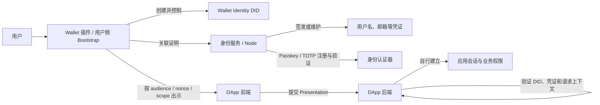

# 钱包身份架构

> 状态：当前实现架构与演进边界
>
> 本文说明 Wallet Identity 与链账户、身份服务、DApp、认证器和应用会话之间的关系。身份对象和安全不变量以[钱包身份模型](../identity/钱包身份模型.md)为准；字段、调用流程及验收规则以链接的协议和测试文档为准。

## 1. 架构定位

钱包身份（DID）是由用户侧创建和控制、可跨 Wallet 和应用引用的身份主体。它与钱包密钥、链账户、邮箱等凭证、Passkey 等认证器和应用会话分别建模。Wallet 负责本地身份控制密钥、用户确认和身份出示；身份服务可验证账户控制证明、签发资料凭证并管理认证器记录；DApp 后端验证身份出示并建立自己的应用会话。



身份服务和 DApp 后端是不同信任边界。身份服务不能代替 DApp 作业务授权，DApp 也不能因用户控制某个链地址而直接获得身份资料或资源权限。

## 2. 核心组件与责任

| 组件 | 当前责任 | 不代表什么 |
| --- | --- | --- |
| Wallet 插件 | 本地创建/选择身份、管理加密控制密钥、关联链账户、请求用户授权、签署 Presentation。 | 不替应用建立业务会话，也不替身份服务签发已验证资料凭证。 |
| 用户侧 Bootstrap | 无插件情况下创建或选择兼容的钱包身份，并参与 Node 身份登录/恢复流程。 | Node 服务端不能因此获得用户身份私钥。 |
| 身份服务（当前主要为 Node） | 验证账户关联证明和资料验证流程，签发/维护凭证及 Passkey 等认证器记录，提供授权或恢复接口。 | Node 数据库 ID、邮箱或 Passkey credential ID 不是 Wallet Identity 的主键。 |
| DApp 前端 | 生成或取得一次性 audience、nonce、scope，调用 Wallet Provider 并提交结果。 | 前端请求参数不是可信身份事实；服务端必须重新验证。 |
| DApp 后端 | 验证 DID 签名、issuer、凭证、audience、nonce、scope 和有效期，再创建本应用会话。 | 一个应用的会话或授权不能自动用于另一个应用或资源服务。 |
| Issuer / 信任配置 | 签发可验证资料并提供验证公钥、状态或撤销信息。 | Wallet 展示的资料值本身不能证明它已经验证。 |

## 3. 身份对象关系

```text
Wallet Identity DID
  ├── controller / recovery controller（用户控制密钥）
  ├── 一个或多个链账户关联证明（chainKey + address）
  ├── issuer 签发的资料凭证（username / email / avatar）
  ├── 身份认证器（Passkey / TOTP）
  └── 按应用请求生成的一次性 Presentation

DApp
  └── 自己的用户记录、登录会话和业务权限
```

DID 不由钱包地址、邮箱、用户名、助记词或服务端数据库 ID 派生。链账户可加入或移除身份；地址变更不会改变 DID。身份凭证的 subject 是 DID；Presentation 绑定具体受众和请求，不是长期访问令牌。详细对象字段、证明格式和生命周期见[钱包身份模型](../identity/钱包身份模型.md)。

## 4. 主要数据流

### 4.1 创建身份与关联账户

1. Wallet 插件或用户侧 Bootstrap 在客户端创建 DID 和本地身份控制密钥。
2. 用户选择链账户，Wallet 取得账户控制证明，并绑定 DID、chainKey、address、用途、nonce 和有效期。
3. 身份服务验证身份 controller 与链账户控制证明，建立 DID 与地址的关联。
4. 用户按需完成邮箱、用户名或头像验证；身份服务对经验证的资料签发凭证。
5. 用户可为 DID 注册 Passkey/TOTP 等身份认证器。

当前账户关联实现主要支持 EVM `eip155:<chainId>` 和对应签名域。其他链的证明必须使用适配器定义的原生签名域，不能把 EVM 的 EIP-191 证明套用到非 EVM 地址。接口和证明要求见[身份协议](../protocols/身份协议.md)与[钱包身份模型](../identity/钱包身份模型.md)。

### 4.2 向应用出示身份

1. DApp 后端创建一次性 `audience`、`nonce`、`scope` 和有效期。
2. DApp 前端请求 Wallet 连接或身份资料权限；Wallet 展示来源和新增 scope，按站点权限规则取得用户确认。
3. Wallet 选择与 scope 匹配且仍有效的已验证凭证，绑定请求上下文并签署 Presentation。
4. DApp 后端独立验证 DID 控制者签名、issuer/凭证状态和请求上下文，消费 nonce。
5. 验证成功后，由 DApp 建立自己的会话并执行自己的业务授权。

Wallet Identity Presentation 与 SIWE 是不同流程：前者出示 DID 和按 scope 选择的资料；SIWE 签署 EVM 地址登录声明。应用可组合使用，但不能把其中一个的成功结果当作另一个流程的授权。具体请求和验证语义见[身份协议](../protocols/身份协议.md)、[连接协议中的 SIWE 登录认证](../protocols/连接协议.md#siwe-登录认证)及[登录验收标准](../钱包测试/登录验收标准.md)。

### 4.3 无插件登录与恢复

Passkey 可以证明用户控制已注册的身份认证器，并支持无插件登录；它本身不导出或恢复 DID controller 私钥。新设备需要通过加密账户文件或密钥托管等明确恢复路径恢复本地密钥材料。WebDAV 普通数据同步只含白名单元数据，也不能恢复身份控制权。

身份密钥加密、恢复授权、不同恢复对象和失败边界见[密钥安全](../钱包安全/密钥安全.md)、[数据安全](../钱包安全/数据安全.md)和[密钥托管验收标准](../钱包测试/密钥托管验收标准.md)。

## 5. 信任边界与安全要求

- **主体控制权**：用户侧控制 DID 的签名密钥；身份服务只验证、签发其职责内的凭证并提供服务接口。
- **地址关联**：地址关联必须同时证明 DID controller 同意和链账户控制权。相同地址不能被两个 active DID 静默占用。
- **凭证真实性**：凭证必须校验 issuer、签名、subject、有效期及状态；未经验证的本地资料不得进入 Presentation。
- **请求绑定**：Presentation 必须绑定 audience、一次性 nonce、批准的 scope 和有效期；服务端验证后消费 nonce，拒绝跨应用或跨请求重放。
- **会话隔离**：身份验证成功不等同于业务权限。DApp 必须自行建立会话并判断资源访问；UCAN 等资源能力另按[权限协议](../protocols/权限协议.md#ucan-能力委托与跨服务授权)验证。
- **恢复安全**：Passkey 登录记录、DID 文档、WebDAV 对象和身份控制私钥属于不同数据。只有经过授权且能在用户侧解密的恢复材料才可恢复身份签名能力。

## 6. 当前实现状态

- Wallet 已实现 DID 创建/选择、链账户关联、资料凭证管理、Passkey/TOTP 管理、身份权限请求和 Presentation 生成等流程；细节以身份系统文档、协议和代码测试为准。
- 当前身份服务提供账户关联、资料验证/签发、认证器注册和恢复相关接口。Node 仍承担重要的 issuer、认证和记录职责；当前实现不应描述为无中心化服务依赖的去中心化身份网络。
- 钱包身份数据模型、认证器、DID 文档、凭证、生命周期和 Provider 协议分别由[身份系统文档](../identity/钱包身份模型.md)、[身份文档规范](../identity/身份文档规范.md)、[身份凭证规范](../identity/身份凭证规范.md)、[身份认证器](../identity/身份认证器.md)、[身份生命周期](../identity/身份生命周期.md)和[身份协议](../protocols/身份协议.md)维护。

## 7. 演进方向

以下内容是长期架构方向，不表示当前已经实现或已排入发布计划：

- **减少单一身份服务依赖**：让身份主体和用户控制密钥保持可携带；Node 可作为凭证 issuer、发现服务和社区服务之一，而不是唯一身份真相源。服务端仍可提供会话、反滥用、审计和撤销服务。
- **多 issuer 与显式信任**：应用配置可接受的 issuer、DID 方法、凭证类型和撤销策略；Presentation 的离线/本地验证能力由各应用的信任策略决定。
- **多设备控制与恢复**：为 controller 增加可迁移设备、恢复策略和明确的撤销流程；任何门限恢复能力必须满足[门限钱包架构的生产准入条件](./门限钱包.md#生产化评审与准入条件)，不能只靠身份模型声明。
- **身份与链协议解耦**：DID 继续作为身份主体，链账户通过可验证证明关联；增加非 EVM 账户时遵循[多链架构](./多链架构.md)的原生地址和签名域边界。

演进不得把邮箱、链地址或 Node 数据库 ID 重新提升为身份主键，也不得静默兼容旧 Passport subject 作为 Wallet Identity。

## 8. 相关文档

- [钱包身份模型](../identity/钱包身份模型.md)：核心对象、关联关系和身份不变量。
- [身份协议](../protocols/身份协议.md)：Provider 请求、scope 与 Presentation 格式。
- [身份文档规范](../identity/身份文档规范.md)与[身份凭证规范](../identity/身份凭证规范.md)：DID Document 和可验证凭证。
- [身份认证器](../identity/身份认证器.md)与[身份生命周期](../identity/身份生命周期.md)：认证器管理及身份恢复流程。
- [登录验收标准](../钱包测试/登录验收标准.md)：SIWE、身份出示、Passkey 和 UCAN 的 Wallet 交互验收。
- [钱包安全与数据恢复](../钱包安全/密钥安全.md)及[数据安全](../钱包安全/数据安全.md)：密钥、备份和恢复边界。
