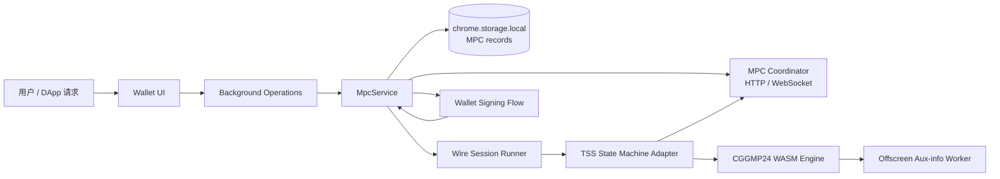

# 门限钱包架构

> 状态：当前实现架构与安全边界
>
> 当前代码包含 MPC 钱包管理、参与者/会话协调、CGGMP24 WebAssembly 协议运行时和签名请求接入。该实现处于生产评审阶段，尚不能据此承诺生产级门限密钥或资产安全。术语见 [Wallet 核心概念](./核心概念.md)，协议与状态细节见[门限协议](../protocols/门限协议.md)。

## 1. 架构目标与范围

门限钱包把签名能力分布在多个参与者设备上。用户设置参与者集合 `N` 和门限 `T`；达到协议要求的参与者共同运行 Keygen、Aux-info 和 Sign 流程。设计目标是让协调器负责会话编排和消息转发，而不持有可单独完成签名的私钥。

本文描述 Wallet 仓库当前的组件、数据流和生产评审状态。协议角色、状态机与数据模型见[门限协议](../protocols/门限协议.md)。

## 2. 组件关系

| 组件 | 当前职责 |
| --- | --- |
| Wallet UI / Background Operations | 创建门限钱包和会话、处理邀请、读取状态、发起签名请求并向上层返回结果。 |
| `MpcService` | 编排协调器授权、会话与成员快照、Keygen/Aux-info/Sign、消息处理、状态收敛和审计。 |
| `MpcCoordinatorClient` | 通过 HTTP / WebSocket 访问协调器的会话、参与者、请求、通知和消息接口。 |
| `MpcWireSessionRunner` | 按 session、协议、请求 ID、参与者索引和序号拉取 wire 消息，并交给本地 TSS adapter。 |
| TSS adapter / CGGMP24 WASM | 在本地推进密码学协议状态，产生或消费协议消息；Aux-info 可委派给 offscreen worker 执行。 |
| 本地 MPC storage | 在 `chrome.storage.local` 保存钱包、参与者、key share、会话、wire state、签名请求、消息和审计记录。 |
| Coordinator | 保存/返回会话元数据并转发消息。Wallet 对协调器操作使用账户签名和授权令牌；协调器不是 Wallet 的本地签名器。 |

## 3. 身份、设备与钱包对象

- **MPC 钱包记录**包含钱包 ID、门限、参与者列表、曲线、版本、会话关联和状态。创建记录不会自动表示该钱包已可签名。
- **参与者记录**将会话内 participant ID 与设备 ID、身份标识、签名公钥和 E2E 公钥关联。创建协调器会话时，Wallet 使用一个已解锁的普通账户签署协调器操作；MPC 账户本身不能为此提供协调器授权签名。
- **设备密钥**由浏览器 WebCrypto 生成：Ed25519 用于设备消息签名，X25519 用于旧式 E2E envelope 的密钥协商。私钥 JWK 使用 Wallet 密码加密后存储。
- **MPC 账户映射**由存储层把 MPC wallet 暴露为 `mpc:<walletId>` 类型账户。此账户地址来自 Keygen 的群组公钥结果；普通 EVM 本地私钥 keyring 不包含其门限私钥。
- **版本字段**`keyVersion` 和 `shareVersion` 用于关联钱包、会话和本地 key share。签名就绪检查要求本地存在匹配版本的完整签名材料。

## 4. 主要协议流程

### 4.1 创建与 Keygen

1. 用户输入名称、参与者、`T` 和曲线。当前入口校验 `T >= 2` 且 `T <= N`。
2. Wallet 生成钱包 ID，使用普通已解锁账户为协调器操作签名，并创建 Keygen 会话。
3. 本地成员加入会话，提交设备标识、公钥和身份信息；协调器返回会话快照。
4. 本地 CGGMP24 引擎运行 Keygen 多轮，wire adapter 发送消息并接收其他参与者的消息。
5. 完成后，Wallet 保存本地 key share 和群组公钥/地址，并将状态推进到 `keygen_completed`。

### 4.2 Aux-info 与本地就绪状态

Keygen 之后还需要 Aux-info 阶段。引擎完成 Aux-info 后尝试生成本地 `completeKeyShare`，并通过本地材料检查确定 `signingStatus`。有地址但没有可用完整签名材料时，钱包仍可能显示为 `keygen_completed` / `signing_unavailable`；只有本地材料检查通过才进入 `active` / `available`。

`available` 只描述本机是否具备启动签名协议的本地材料，不保证其他参与者在线，也不表示达到门限或整个协议可在当前环境成功完成。

### 4.3 签名请求

Wallet 的 Web3 签名和交易入口创建 MPC 签名请求，并检查钱包状态、参与者和本地 key share。各参与设备通过协调器交换签名协议消息；本地 runner 按 session、protocol、request ID 和序号读取消息、推进 TSS 状态机并保存进度。协议成功后，签名结果回写签名请求，再由钱包现有链交易流程完成 EVM 交易组装或向请求方返回签名。

MPC 请求经独立 `MpcService` 编排，不通过本地 `registry.getSigner()` 将门限密钥伪装为普通 `Signer`。当前交易组装和恢复 ID 处理仍有 EVM 专属逻辑，不能视为已具备通用多链 MPC 签名支持。

## 5. 状态与持久化

钱包状态、协议会话状态、签名请求状态分开维护：

| 层级 | 示例状态 | 表示什么 |
| --- | --- | --- |
| 钱包 | `keygen_ready`、`keygen_running`、`keygen_completed`、`active`、`signing_unavailable` | 账户是否已有地址、本地是否有可用签名材料。 |
| 会话 | `ready`、`rounds`、`keygen_completed`、`active`、`failed` | 一次 Keygen、Aux-info 或 Sign 协议的进度。 |
| 签名请求 | `pending`、`approved`、`rounds`、`completed`、`failed` | 一次具体消息或交易签名的审批及协议进度。 |

主要存储集合为 `mpc_wallets`、`mpc_participants`、`mpc_key_shares`、`mpc_sessions`、`mpc_wire_states`、`mpc_sign_requests`、`mpc_messages` 和 `mpc_audit_logs`。WASM 会话状态能否安全持久化取决于引擎导出能力；标记为不可持久化的状态不能当作可恢复快照。

## 6. 信任与数据边界

| 数据/通道 | 当前处理 | 架构含义 |
| --- | --- | --- |
| 设备签名私钥、设备 E2E 私钥 | 以 Wallet 密码加密后写入本地设备密钥记录。 | 设备身份密钥有应用层静态加密。 |
| MPC key share / `completeKeyShare` | `mpc-storage` 将 share 记录直接写入 `chrome.storage.local`；该存储封装没有再调用 Wallet 密码加密。 | 当前不能把 key share 持久化描述为已实现密码加密保护，需纳入安全整改和生产准入。 |
| 旧式 session message envelope | X25519 派生 AES-GCM 密钥加密 payload，并用设备 Ed25519 密钥签名 envelope。 | 此路径具备收件人级加密和签名校验。 |
| CGGMP24 wire message | 当前 wire 发送路径把协议 payload 放入消息 envelope，并对协调器操作体进行普通账户签名；未调用旧式 `encryptEnvelope`。 | 不应假设 wire payload 对协调器保密；协调器可见到传输内容。需确认密码学协议消息本身是否包含敏感信息并确定加密/隐私要求。 |
| 协调器会话数据 | 服务端负责会话接口、消息转发和事件流。 | 协调器是可用性和消息路由依赖；Wallet 仍需校验协议版本、参与方、序号和结果。 |
| 审计记录 | 本地记录会话和请求事件，可配置导出。 | 审计数据不能包含私钥、key share 明文或可重放授权秘密。 |

## 7. 当前实现状态与生产限制

- 代码包含 CGGMP24 WASM Keygen、Aux-info、Sign 适配层、wire 消息协议、会话恢复/看门狗逻辑和钱包状态收敛机制。
- 当前 WASM 构建仍是 `dev-verification`，且独立安全审计、生产构建验证、多设备互操作、分片生命周期保护及参与者绑定等准入项未完成。具体状态见本文[生产化评审与准入条件](#生产化评审与准入条件)。
- `MpcService` 中存在 dev-verification 相关 Aux-info 快捷路径和 gate。任何构建配置或路径变化都必须重新核查，不能仅依赖 UI 默认隐藏。
- Key share 当前未在 MPC storage 封装处密码加密；wire 消息当前未使用旧式 E2E envelope。这两点是当前架构的实际安全缺口，生产化前必须有明确修复和验证结论。
- 参与者增删、设备替换、refresh/resharing、分片备份/恢复/轮换/销毁和高风险交易策略需按专项文档评审，不得仅修改参与者列表或版本字段来模拟安全协议。

## 8. 代码入口与文档

- `js/background/operations/mpc.js`：钱包/会话操作入口。
- `js/background/mpc-service.js`：协调器、协议编排、状态收敛及审计。
- `js/background/mpc-coordinator-client.js`：HTTP / WebSocket 客户端。
- `js/background/mpc-wire-protocol.js`、`mpc-wire-session-runner.js`、`mpc-tss-engine.js`：wire 格式、消息推进和 TSS adapter。
- `js/background/mpc-cggmp24-wasm-engine.js`、`mpc-cggmp24-runtime.js`：CGGMP24 WASM 与 offscreen runtime。
- `js/background/mpc-crypto.js`、`js/storage/mpc-storage.js`：设备密钥、加密 envelope 和 MPC 持久化。
- [门限协议](../protocols/门限协议.md)：对象、协议状态机、API 约定、验收用例和威胁模型。

## 9. 生产化评审与准入条件

### 当前决策

2026-09-12 的决策解除 2026-08-08“不得接收生产资产、不得进入生产交易签名路径”的前置禁令，并允许在受控环境继续生产评审。该决策没有批准面向终端用户的生产发布，也没有证明当前实现具有生产级资产安全。MPC UI 入口默认隐藏；在新安全评审结论形成前，不得将 MPC 宣传为生产级门限钱包。

当前工作区代码为 dev-verification 构建（`securityProfile: 'dev-verification'`、`productionSafe: false`）。生产安全构建尚未完成编译和真机验证。`MpcService` 的 `_completeKeyShareFromDevTrustedAuxInfo` 路径受 `_isDevFallbackAllowed` gate 约束；当前 gate 会在 `productionSafe === true` 或元数据缺失时拒绝 dev fallback。dev-verification 快捷路径不能作为真实门限 Aux-info 成功的证据，也不能用于证明生产安全。

已有性能观测仅适用于 dev-verification 构建：真机 Chrome 上 6→4 并行素数生成中位数 34.9 秒、最坏 66.6 秒；productionSafe 构建未验证，不能由该数据推断其性能。Aux-info 的 deadline、代际重试和 watchdog 已有代码路径，但 Service Worker 被终止后经 watchdog 恢复的真机端到端验收尚未完成。

### 生产准入条件

以下条件全部完成并形成新的安全评审结论前，MPC 不得作为生产级钱包能力发布：

1. 选择维护活跃、支持目标曲线且具有公开安全模型的门限签名实现。
2. 获得与目标版本、编译产物和集成方式对应的独立安全审计报告。
3. 完成 Keygen、Sign、Refresh/Resharing 的多实现或多设备互操作测试。
4. 覆盖参与者掉线、消息乱序、重放、重复提交、恶意输入和协调器故障。
5. 定义密钥分片的加密存储、备份、恢复、迁移、轮换和销毁流程。
6. 完成参与者身份绑定、设备替换、成员增加和移除的安全协议。
7. 建立交易内容确认、门限责任展示和高风险操作再认证。
8. 在真实浏览器和目标设备上完成持续端到端测试、故障注入及恢复演练。
9. 关闭安全评审中的所有高风险问题，并为剩余风险形成书面接受记录。

### 已知未完成项

截至 2026-09-12 的评审记录，以下验证仍待完成；每项完成后应更新本文并附上可复核证据：

| 项目 | 状态 | 说明 |
| --- | --- | --- |
| 真机 2 方 / 3 方端到端验收 | 未完成 | 需验证多参与者真实 Keygen、Aux-info 和 Sign。 |
| 完整自动化测试 | 未完成 | MPC 长跑和 keyring IPC flake 尚待处理并复验。 |
| 独立安全审计 | 未完成 | 审计必须覆盖目标 WASM 构建、集成和实际发布产物。 |
| 持久化崩溃恢复真机验证 | 未完成 | 代码审阅不足以替代 Service Worker 终止、watchdog 触发和代际重启的端到端验证。 |
| 监控与告警 | 未完成 | 需覆盖协议失败、参与者离线、恢复耗尽及协调器异常。 |
| productionSafe WASM 构建 | 未完成 | 当前 dev-verification 构建不能代表生产安全参数构建。 |
| key share 生命周期保护 | 未完成 | 加密存储、备份、恢复、迁移、轮换和销毁流程尚未齐备。 |
| 参与者与设备安全协议 | 未完成 | 身份绑定、设备替换、成员增删及 refresh/resharing 需完整定义并验证。 |

具体验收至少包括 productionSafe 构建、双方独立保存 `completeKeyShare`、真实执行 2-of-2 签名并验证 ECDSA 签名与钱包地址匹配，以及持久化崩溃恢复、多设备互操作和安全审计。WASM metadata、Keygen 完成或 UI 显示“签名准备中”均不能单独视为通过。

发布仍须保持以下约束：MPC 入口明确标记实验状态；默认发布配置不将 MPC 设为推荐钱包类型；Wallet、Coordinator 和业务应用使用兼容协议版本并禁止静默降级；协议状态不一致时停止签名；生产化变更必须引用新的架构决策和安全评审结论。
